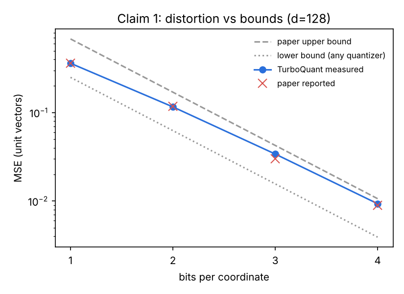
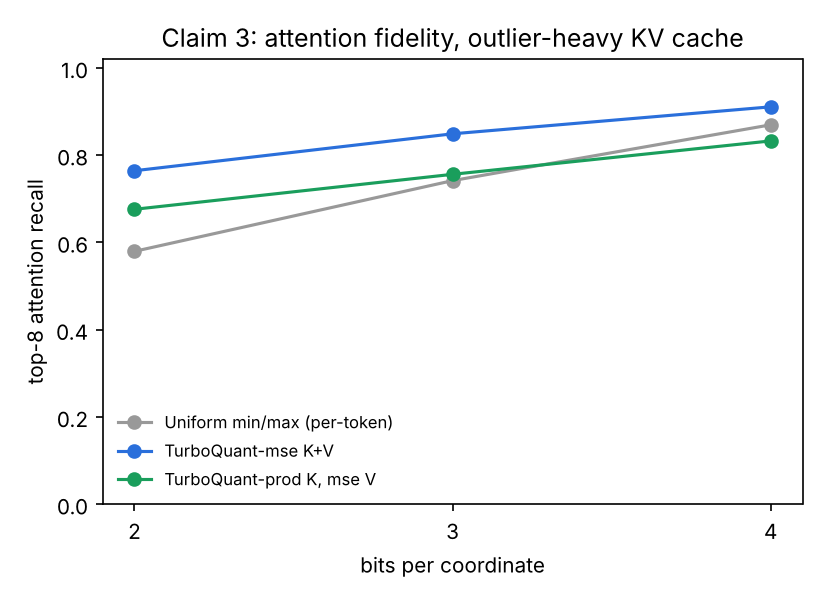

# 01 · TurboQuant: 2-4 bit KV-cache compression with no calibration

**Paper:** Zandieh, Daliri, Hadian, Mirrokni. *TurboQuant: Online Vector Quantization with Near-optimal Distortion Rate.* [arXiv:2504.19874](https://arxiv.org/abs/2504.19874), ICLR 2026.

**Why it matters on-device:** the KV cache, not the weights, is what runs a phone or laptop out of memory on long contexts. TurboQuant compresses each cached vector the moment it is written: no calibration data, no training, no per-model tuning. It just applies one random rotation and a fixed codebook.

## The idea in one paragraph

Randomly rotate a vector and every coordinate ends up with the same, known, near-Gaussian distribution, whatever the input looked like (outlier channels included). So you can precompute a single optimal scalar quantizer (Lloyd-Max) for that distribution and apply it coordinate by coordinate. The paper proves that this lands within a factor of about 2.7 of the best distortion *any* quantizer can achieve. A second variant spends 1 of the bits on a 1-bit sketch of the residual (QJL), which makes inner-product estimates unbiased.

## Claims tested

| # | Claim | Verdict |
|---|---|---|
| 1 | MSE distortion is between the lower bound `4^-b` and `2.72 · 4^-b`, and matches the paper's reported 0.36 / 0.117 / 0.03 / 0.009 at 1-4 bits | ✅ **Reproduced.** Measured 0.361 / 0.116 / 0.034 / 0.0093 at d=128, and the same at d=1024 |
| 2 | The MSE quantizer biases inner products (×2/π at 1 bit), the prod variant is unbiased | ✅ **Reproduced.** Slope 0.639 vs theory 0.637; prod slope is 1.00 ± 0.003 at every bit width |
| 3 | *(application)* On a KV cache with outlier channels, TurboQuant keeps attention far closer to fp16 than standard per-token int quantization at the same memory | ✅ **at 2-3 bits**, ≈ at 4 bits. See below |

### Claim 3 in numbers (4,096 tokens, d=128, mean of 5 random rotations)

| bits/coord (incl. overhead) | memory vs fp16 | Uniform min/max KL ↓ | **TurboQuant-mse KL ↓** | Uniform top-8 recall | **TurboQuant top-8 recall** |
|---|---|---|---|---|---|
| ~2.1-2.25 | 7.1-7.5× smaller | 7.19 | **0.29** (25× lower) | 0.58 | **0.76** |
| ~3.1-3.25 | 4.9-5.1× smaller | 0.49 | **0.15** (3× lower) | 0.74 | **0.85** |
| ~4.1-4.25 | 3.8-3.9× smaller | 0.085 | 0.091 (parity) | 0.87 | **0.91** |

Full tables: [`results/results.md`](results/results.md).




## What I found that the abstract doesn't tell you

1. **For softmax attention, unbiased is not better.** TurboQuant-prod (unbiased inner products) did *worse* than plain TurboQuant-mse on keys at every bit width (KL 2.35 vs 0.29 at 2 bits). Softmax exponentiates logit errors, so the extra variance from the 1-bit QJL sketch hurts more than a small, consistent shrinkage, and a uniform shrink of all logits barely changes the ranking. Use the prod variant for retrieval and inner-product search. For KV caches, the MSE variant is the safer default.
2. **The win is concentrated at the low-bit end.** At 2-3 bits, per-token min/max collapses because outlier channels stretch the range and leave almost no levels for the other 124 channels. The rotation spreads outliers across all coordinates, which is why TurboQuant degrades gracefully. At 4 bits both methods are fine.
3. **Seed hygiene matters.** My first version seeded the rotation with the same RNG stream as the test data, so the "random" rotation equalled the first 128 data points and the 4-bit MSE came out 1.6× above the paper's upper bound. The guarantee assumes the rotation is independent of the data. The implementation now draws it from a separate seed stream, and a test pins that.
4. **Cost:** about 235k vectors/s per core for 3-bit quantization in plain NumPy, half the speed of min/max. It's one 128×128 matmul plus a `searchsorted` per vector, cheap enough to run on every decode step.

## Run it

```bash
pip install numpy matplotlib pytest
python run.py           # ~15 s on a laptop CPU, writes results/
python run.py --quick   # ~3 s
python -m pytest -q     # 10 checks of the paper's guarantees, ~2 s
```

## Files

- `turboquant.py`: TurboQuant-mse, TurboQuant-prod (MSE + QJL) and the per-token min/max baseline, about 150 lines of NumPy. Bit accounting includes per-vector norms and scales.
- `run.py`: the three claims plus throughput. Writes `results/results.md` and plots.
- `test_turboquant.py`: asserts the paper's bounds, the unbiasedness, the 2/π shrinkage, and the bit accounting.

## Limitations and next steps

- Claim 3 uses a **synthetic** KV cache that mimics known structure (a few persistent high-magnitude key channels, varying token norms). Next: dump real K/V tensors from a small model (e.g. SmolLM2-135M or Qwen3-0.6B) and measure perplexity at each bit width.
- Codes are stored one per `uint8` for clarity. Real memory savings need bit-packing. The bit counts in the tables are the packed sizes.
- Next experiment builds on this one: per-token adaptive bit allocation ([Don't Waste Bits!, arXiv:2604.04722](https://arxiv.org/abs/2604.04722)).
