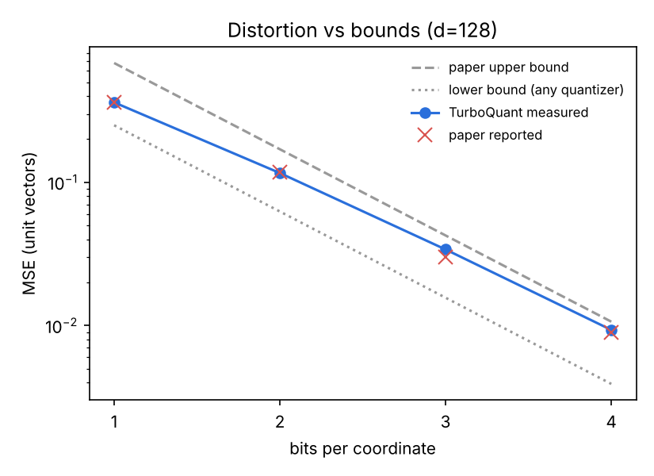
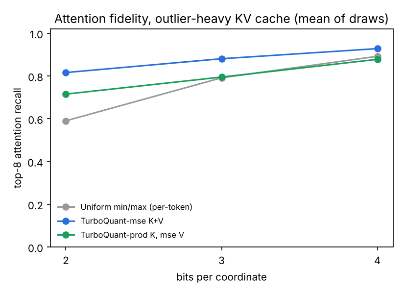

# 01 · TurboQuant: details

**Paper:** Zandieh, Daliri, Hadian, Mirrokni. *TurboQuant: Online Vector Quantization with Near-optimal Distortion Rate.* [arXiv:2504.19874](https://arxiv.org/abs/2504.19874), ICLR 2026.
**Why it matters on-device:** the KV cache, not the weights, is what runs out of memory on long contexts. TurboQuant compresses each cached vector the moment it is written, with no calibration data.
**Size budget:** pure NumPy, peak RAM < 300 MB, nothing downloaded, no training. Committed artifacts are about 150 KB (code + plots).

Every number here comes from [`results/details.md`](../results/details.md), which `run.py` regenerates.

## The idea in one paragraph

After a random rotation, every coordinate of a unit vector follows the same known distribution, f(t) ∝ (1−t²)^((d−3)/2), which is close to N(0, 1/d). So one Lloyd-Max scalar codebook, computed once for that distribution, is near-optimal for any input. The paper proves an MSE of at most (√3·π/2)·4^(−b), within about 2.7× of the 4^(−b) lower bound. **TurboQuant-prod** spends 1 of the b bits on a QJL sign sketch of the residual, which makes inner-product estimates unbiased.

## Hypothesis and pass criteria

| # | Criterion | Threshold | Source |
|---|---|---|---|
| C1 ★ | MSE ≤ paper upper bound, b = 1..4 | ratio ≤ 1.0 | Theorem 1 |
| C2 | MSE within 15% of reported 0.36 / 0.117 / 0.03 / 0.009 | ≤ 0.15 | Paper's reported values (rounded) |
| C3 | TurboQuant-prod unbiased: \|slope − 1\| | ≤ 0.02 | Theorem 2 |
| C4 | 1-bit MSE shrink factor = 2/π | ±0.02 | Paper, sec. 3.2 |
| C5 | 3-bit attention KL ≤ 0.5 × per-token min/max KL | ≤ 0.5 | Baseline (KIVI-style) |
| N1 | *Negative control:* no rotation, outlier keys, within bound | should FAIL | — |

Criteria were retro-registered: they were written after a first exploratory run, with thresholds taken from the paper and the baseline, not tuned to the results. C5 was then judged on two context lengths. The 1,024-token case was added before I knew it would fail. From experiment 02 on, criteria are committed before the first full run.

## Controls

- **Baseline:** per-token asymmetric min/max int quantization with fp16 scale + zero point, the standard KV-cache scheme. Bit counts include each method's side information: norms for TurboQuant, scale + zero for the baseline.
- **Negative control (N1):** the identical codebook without the rotation. On outlier-heavy keys the MSE is 7.3× over the bound, so the test can tell a working method from a broken one.
- **Perturbations:** C1 is checked at d ∈ {64, 128, 1024} × 3 seeds. C3-C4 use 3 seeds. C5 uses 2 context lengths (1,024 and 4,096 tokens) × 3 data draws × 5 rotations. A criterion passes only if it holds on every perturbation.

| Criterion | Perturbations passing |
|---|---|
| C1 | 36 / 36 (3 dims × 3 seeds × 4 bit widths) |
| C3, C4 | all seeds |
| C5 | 5 / 6 KV caches (fails on 1,024 tokens, data draw 0: ratio 1.05) |

## Results

| Bits | MSE (d=128) | Paper | Lower bound | Upper bound |
|---|---|---|---|---|
| 1 | 0.361 | 0.36 | 0.250 | 0.680 |
| 2 | 0.116 | 0.117 | 0.0625 | 0.170 |
| 3 | 0.034 | 0.03 | 0.0156 | 0.0425 |
| 4 | 0.0093 | 0.009 | 0.0039 | 0.0106 |

At 3 bits (about 5× smaller than fp16), the attention KL ratio of TurboQuant-mse to min/max on the six caches was 0.17-0.47 on five of them and 1.05 on the sixth. Top-8 attention recall was higher for TurboQuant on all six, including the one where KL lost (0.92 vs 0.83).

## What I found that the abstract doesn't tell you

1. **For softmax attention, unbiased is not better.** TurboQuant-prod is worse than TurboQuant-mse for keys at every bit width. Softmax exponentiates logit errors, so the QJL sketch's extra variance hurts more than a small, consistent shrinkage, which barely changes the ranking. Use prod for retrieval and inner-product search. For KV caches, MSE is the safer default.
2. **The rotation is a lottery.** On the cache that failed C5, the attention KL's standard deviation across 5 random rotations was 1.1× its mean. The guarantee is on *expected* MSE. A single fixed rotation per model can be an unlucky draw for a specific cache. That suggests a cheap fix: draw k rotations and keep the best on a few calibration tokens. This is the follow-up below.
3. **The win is concentrated at 2-3 bits.** Per-token min/max collapses there, because outlier channels stretch its range. At 4 bits both methods are fine.
4. **Seed hygiene matters.** My first version drew the rotation from the same RNG stream as the test data, so the "random" rotation was correlated with the data. The 4-bit MSE came out 1.6× over the paper's bound. The rotation now uses a separate seed stream, and `test_mse_within_paper_bounds` would catch a regression.
5. **Cost:** about 235k vectors/s per core for 3-bit quantization in NumPy, half the speed of min/max: one d×d matmul plus a `searchsorted`.

## Limitations and next steps

- The KV cache is **synthetic** (persistent outlier channels, log-normal token norms, sharp queries). Its attention logits are larger than most real models produce, which probably exaggerates the KL tails. Next: real K/V tensors from a small open model, plus perplexity per bit width. That needs model downloads, which go through Obi's GPU machine.
- Codes are stored as `uint8` for clarity. Real savings need bit-packing; the tables report packed sizes.
- **Follow-up idea (01b): best-of-k rotations.** Pick the best of 8 rotations per layer using 64 calibration tokens, then test whether that closes C5's tail at the same bit width.
