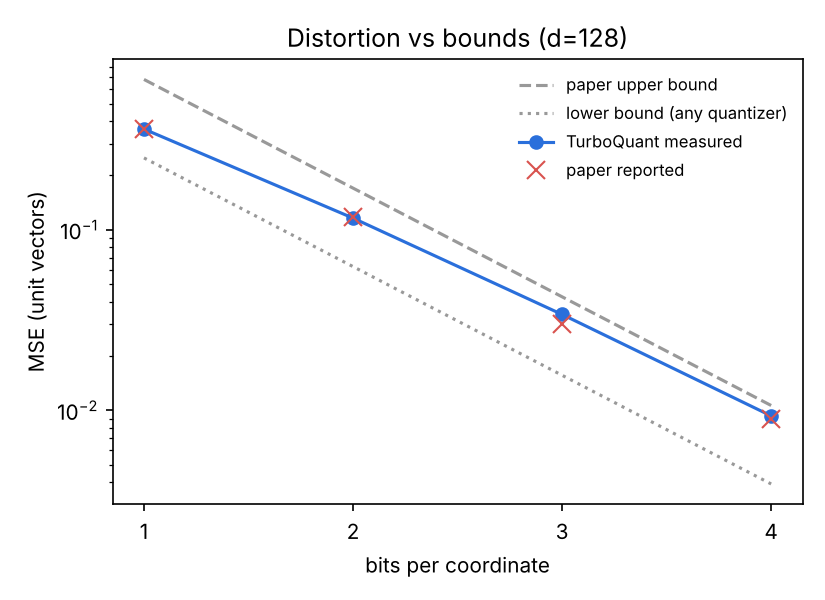
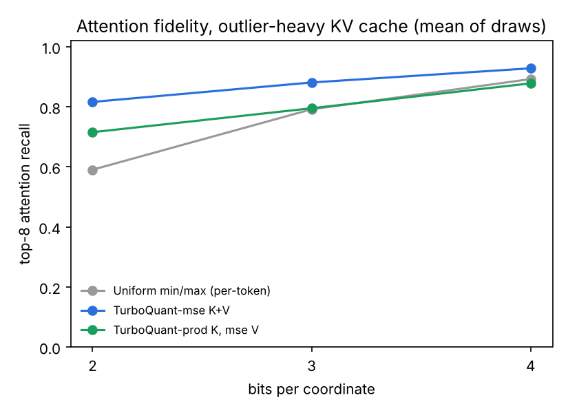

# Experiment 01 · full results

_full run, 47.4s. Verdict **INCONCLUSIVE** (4/5). Generated by `run.py`; do not edit._

## Criteria

| id | name | value | op | threshold | result | source |
|---|---|---|---|---|---|---|
| C1 | MSE within the paper's proven bounds (1-4 bits) | 0.8915 | <= | 1.0 | PASS | Thm 1: MSE <= (sqrt3*pi/2)*4^-b; worst case over bits, dims, seeds |
| C2 | MSE matches the paper's reported values | 0.1325 | <= | 0.15 | PASS | Paper reports 0.36/0.117/0.03/0.009 (rounded); allow +-15% |
| C3 | TurboQuant-prod inner products are unbiased | 0.0024 | <= | 0.02 | PASS | Thm 2: E[<y, x_hat>] = <y, x>; |slope-1| over bits 1-4 |
| C4 | 1-bit MSE quantizer shrinks inner products by 2/pi | 0.0026 | <= | 0.02 | PASS | Paper sec. 3.2: bias factor 2/pi = 0.637 at b=1 |
| C5 | 3-bit KV cache: attention error at most half of per-token int quantization | 1.0495 | <= | 0.5 | FAIL | Baseline: per-token min/max (KIVI-style) at equal or more bits/coord; worst case over 3 data draws x 2 context lengths |
| N1 | No random rotation stays within the MSE bound on outlier-heavy keys | 7.2623 | <= | 1.0 | FAIL | Same codebook without the rotation: the guarantee no longer applies |

## 1 · MSE vs bounds (unit vectors, every dim and seed)

| d | seed | bits | mse | paper | lower | upper | ratio_upper |
|---|---|---|---|---|---|---|---|
| 64 | 0 | 1 | 0.3585 | 0.36 | 0.2500 | 0.6802 | 0.527 |
| 64 | 0 | 2 | 0.1145 | 0.117 | 0.0625 | 0.1700 | 0.673 |
| 64 | 0 | 3 | 0.0334 | 0.03 | 0.0156 | 0.0425 | 0.785 |
| 64 | 0 | 4 | 0.0091 | 0.009 | 0.0039 | 0.0106 | 0.859 |
| 64 | 1 | 1 | 0.3583 | 0.36 | 0.2500 | 0.6802 | 0.527 |
| 64 | 1 | 2 | 0.1144 | 0.117 | 0.0625 | 0.1700 | 0.672 |
| 64 | 1 | 3 | 0.0333 | 0.03 | 0.0156 | 0.0425 | 0.784 |
| 64 | 1 | 4 | 0.0091 | 0.009 | 0.0039 | 0.0106 | 0.858 |
| 64 | 2 | 1 | 0.3586 | 0.36 | 0.2500 | 0.6802 | 0.527 |
| 64 | 2 | 2 | 0.1146 | 0.117 | 0.0625 | 0.1700 | 0.674 |
| 64 | 2 | 3 | 0.0334 | 0.03 | 0.0156 | 0.0425 | 0.785 |
| 64 | 2 | 4 | 0.0091 | 0.009 | 0.0039 | 0.0106 | 0.857 |
| 128 | 0 | 1 | 0.3612 | 0.36 | 0.2500 | 0.6802 | 0.531 |
| 128 | 0 | 2 | 0.1160 | 0.117 | 0.0625 | 0.1700 | 0.682 |
| 128 | 0 | 3 | 0.0339 | 0.03 | 0.0156 | 0.0425 | 0.798 |
| 128 | 0 | 4 | 0.0093 | 0.009 | 0.0039 | 0.0106 | 0.876 |
| 128 | 1 | 1 | 0.3610 | 0.36 | 0.2500 | 0.6802 | 0.531 |
| 128 | 1 | 2 | 0.1161 | 0.117 | 0.0625 | 0.1700 | 0.683 |
| 128 | 1 | 3 | 0.0340 | 0.03 | 0.0156 | 0.0425 | 0.800 |
| 128 | 1 | 4 | 0.0093 | 0.009 | 0.0039 | 0.0106 | 0.877 |
| 128 | 2 | 1 | 0.3606 | 0.36 | 0.2500 | 0.6802 | 0.530 |
| 128 | 2 | 2 | 0.1161 | 0.117 | 0.0625 | 0.1700 | 0.683 |
| 128 | 2 | 3 | 0.0340 | 0.03 | 0.0156 | 0.0425 | 0.800 |
| 128 | 2 | 4 | 0.0093 | 0.009 | 0.0039 | 0.0106 | 0.878 |
| 1024 | 0 | 1 | 0.3629 | 0.36 | 0.2500 | 0.6802 | 0.534 |
| 1024 | 0 | 2 | 0.1173 | 0.117 | 0.0625 | 0.1700 | 0.690 |
| 1024 | 0 | 3 | 0.0345 | 0.03 | 0.0156 | 0.0425 | 0.811 |
| 1024 | 0 | 4 | 0.0095 | 0.009 | 0.0039 | 0.0106 | 0.892 |
| 1024 | 1 | 1 | 0.3629 | 0.36 | 0.2500 | 0.6802 | 0.534 |
| 1024 | 1 | 2 | 0.1172 | 0.117 | 0.0625 | 0.1700 | 0.689 |
| 1024 | 1 | 3 | 0.0345 | 0.03 | 0.0156 | 0.0425 | 0.811 |
| 1024 | 1 | 4 | 0.0095 | 0.009 | 0.0039 | 0.0106 | 0.891 |
| 1024 | 2 | 1 | 0.3629 | 0.36 | 0.2500 | 0.6802 | 0.534 |
| 1024 | 2 | 2 | 0.1173 | 0.117 | 0.0625 | 0.1700 | 0.690 |
| 1024 | 2 | 3 | 0.0345 | 0.03 | 0.0156 | 0.0425 | 0.811 |
| 1024 | 2 | 4 | 0.0095 | 0.009 | 0.0039 | 0.0106 | 0.891 |

## 2 · Inner-product bias (slope 1.0 = unbiased; 2/pi = 0.637)

| method | seed | bits | slope | rmse |
|---|---|---|---|---|
| TurboQuant-mse | 0 | 1 | 0.639 | 0.2177 |
| TurboQuant-prod | 0 | 1 | 0.998 | 0.0593 |
| TurboQuant-mse | 0 | 2 | 0.884 | 0.0734 |
| TurboQuant-prod | 0 | 2 | 0.999 | 0.0439 |
| TurboQuant-mse | 0 | 3 | 0.966 | 0.0259 |
| TurboQuant-prod | 0 | 3 | 1.000 | 0.0263 |
| TurboQuant-mse | 0 | 4 | 0.991 | 0.0107 |
| TurboQuant-prod | 0 | 4 | 1.000 | 0.0145 |
| TurboQuant-mse | 1 | 1 | 0.639 | 0.2177 |
| TurboQuant-prod | 1 | 1 | 0.999 | 0.0592 |
| TurboQuant-mse | 1 | 2 | 0.884 | 0.0736 |
| TurboQuant-prod | 1 | 2 | 0.999 | 0.0440 |
| TurboQuant-mse | 1 | 3 | 0.966 | 0.0260 |
| TurboQuant-prod | 1 | 3 | 1.000 | 0.0264 |
| TurboQuant-mse | 1 | 4 | 0.991 | 0.0106 |
| TurboQuant-prod | 1 | 4 | 1.000 | 0.0144 |
| TurboQuant-mse | 2 | 1 | 0.639 | 0.2181 |
| TurboQuant-prod | 2 | 1 | 1.002 | 0.0596 |
| TurboQuant-mse | 2 | 2 | 0.884 | 0.0734 |
| TurboQuant-prod | 2 | 2 | 1.001 | 0.0441 |
| TurboQuant-mse | 2 | 3 | 0.966 | 0.0257 |
| TurboQuant-prod | 2 | 3 | 1.001 | 0.0263 |
| TurboQuant-mse | 2 | 4 | 0.991 | 0.0106 |
| TurboQuant-prod | 2 | 4 | 1.000 | 0.0147 |

## 3 · Attention on a compressed, outlier-heavy KV cache

1,024- and 4,096-token caches, d=128, 3 data draws each. kl = KL(fp attention || quantized), mean over random rotations; top8 = overlap of the 8 most-attended tokens; out_cos = cosine of attention outputs. bits_per_coord includes norms/scales; fp16 = 16.

| context | data_seed | method | bits | bits_per_coord | compression | kl | kl_std | top8 | out_cos |
|---|---|---|---|---|---|---|---|---|---|
| 1024 | 0 | Uniform min/max (per-token) | 2 | 2.25 | 7.1x | 6.1452 | 0.0000 | 0.659 | 0.6035 |
| 1024 | 0 | TurboQuant-mse K+V | 2 | 2.12 | 7.5x | 0.3667 | 0.2356 | 0.843 | 0.8862 |
| 1024 | 0 | TurboQuant-prod K, mse V | 2 | 2.25 | 7.1x | 2.5837 | 1.4547 | 0.775 | 0.7528 |
| 1024 | 0 | Uniform min/max (per-token) | 3 | 3.25 | 4.9x | 0.3314 | 0.0000 | 0.826 | 0.9266 |
| 1024 | 0 | TurboQuant-mse K+V | 3 | 3.12 | 5.1x | 0.3478 | 0.3949 | 0.918 | 0.9320 |
| 1024 | 0 | TurboQuant-prod K, mse V | 3 | 3.25 | 4.9x | 0.9167 | 0.5334 | 0.841 | 0.8825 |
| 1024 | 0 | Uniform min/max (per-token) | 4 | 4.25 | 3.8x | 0.1125 | 0.0000 | 0.922 | 0.9631 |
| 1024 | 0 | TurboQuant-mse K+V | 4 | 4.12 | 3.9x | 0.0494 | 0.0336 | 0.945 | 0.9834 |
| 1024 | 0 | TurboQuant-prod K, mse V | 4 | 4.25 | 3.8x | 0.1580 | 0.0776 | 0.904 | 0.9725 |
| 1024 | 1 | Uniform min/max (per-token) | 2 | 2.25 | 7.1x | 21.8972 | 0.0000 | 0.657 | 0.2382 |
| 1024 | 1 | TurboQuant-mse K+V | 2 | 2.12 | 7.5x | 0.5293 | 0.2897 | 0.826 | 0.8563 |
| 1024 | 1 | TurboQuant-prod K, mse V | 2 | 2.25 | 7.1x | 1.5107 | 0.6441 | 0.723 | 0.8093 |
| 1024 | 1 | Uniform min/max (per-token) | 3 | 3.25 | 4.9x | 0.3148 | 0.0000 | 0.825 | 0.9123 |
| 1024 | 1 | TurboQuant-mse K+V | 3 | 3.12 | 5.1x | 0.1487 | 0.0498 | 0.887 | 0.9399 |
| 1024 | 1 | TurboQuant-prod K, mse V | 3 | 3.25 | 4.9x | 0.7060 | 0.3813 | 0.803 | 0.8933 |
| 1024 | 1 | Uniform min/max (per-token) | 4 | 4.25 | 3.8x | 0.1113 | 0.0000 | 0.891 | 0.9656 |
| 1024 | 1 | TurboQuant-mse K+V | 4 | 4.12 | 3.9x | 0.0333 | 0.0191 | 0.936 | 0.9792 |
| 1024 | 1 | TurboQuant-prod K, mse V | 4 | 4.25 | 3.8x | 0.3458 | 0.3739 | 0.880 | 0.9313 |
| 1024 | 2 | Uniform min/max (per-token) | 2 | 2.25 | 7.1x | 17.4739 | 0.0000 | 0.607 | 0.5137 |
| 1024 | 2 | TurboQuant-mse K+V | 2 | 2.12 | 7.5x | 1.2056 | 0.2569 | 0.834 | 0.7746 |
| 1024 | 2 | TurboQuant-prod K, mse V | 2 | 2.25 | 7.1x | 4.8399 | 1.5528 | 0.755 | 0.6299 |
| 1024 | 2 | Uniform min/max (per-token) | 3 | 3.25 | 4.9x | 2.0301 | 0.0000 | 0.801 | 0.7722 |
| 1024 | 2 | TurboQuant-mse K+V | 3 | 3.12 | 5.1x | 0.3446 | 0.1737 | 0.902 | 0.9075 |
| 1024 | 2 | TurboQuant-prod K, mse V | 3 | 3.25 | 4.9x | 1.7709 | 0.8097 | 0.826 | 0.7791 |
| 1024 | 2 | Uniform min/max (per-token) | 4 | 4.25 | 3.8x | 1.0111 | 0.0000 | 0.902 | 0.8344 |
| 1024 | 2 | TurboQuant-mse K+V | 4 | 4.12 | 3.9x | 0.1291 | 0.0862 | 0.944 | 0.9575 |
| 1024 | 2 | TurboQuant-prod K, mse V | 4 | 4.25 | 3.8x | 0.7912 | 0.4236 | 0.893 | 0.8685 |
| 4096 | 0 | Uniform min/max (per-token) | 2 | 2.25 | 7.1x | 8.8974 | 0.0000 | 0.531 | 0.6179 |
| 4096 | 0 | TurboQuant-mse K+V | 2 | 2.12 | 7.5x | 0.4648 | 0.2450 | 0.784 | 0.8801 |
| 4096 | 0 | TurboQuant-prod K, mse V | 2 | 2.25 | 7.1x | 1.4661 | 0.4908 | 0.673 | 0.8411 |
| 4096 | 0 | Uniform min/max (per-token) | 3 | 3.25 | 4.9x | 0.7484 | 0.0000 | 0.741 | 0.9158 |
| 4096 | 0 | TurboQuant-mse K+V | 3 | 3.12 | 5.1x | 0.1512 | 0.0645 | 0.844 | 0.9482 |
| 4096 | 0 | TurboQuant-prod K, mse V | 3 | 3.25 | 4.9x | 0.4955 | 0.1736 | 0.761 | 0.9231 |
| 4096 | 0 | Uniform min/max (per-token) | 4 | 4.25 | 3.8x | 0.1595 | 0.0000 | 0.873 | 0.9698 |
| 4096 | 0 | TurboQuant-mse K+V | 4 | 4.12 | 3.9x | 0.1271 | 0.0497 | 0.904 | 0.9686 |
| 4096 | 0 | TurboQuant-prod K, mse V | 4 | 4.25 | 3.8x | 0.2270 | 0.1083 | 0.856 | 0.9614 |
| 4096 | 1 | Uniform min/max (per-token) | 2 | 2.25 | 7.1x | 22.5914 | 0.0000 | 0.510 | 0.1930 |
| 4096 | 1 | TurboQuant-mse K+V | 2 | 2.12 | 7.5x | 1.7407 | 0.9613 | 0.787 | 0.7361 |
| 4096 | 1 | TurboQuant-prod K, mse V | 2 | 2.25 | 7.1x | 5.9979 | 2.7624 | 0.650 | 0.5739 |
| 4096 | 1 | Uniform min/max (per-token) | 3 | 3.25 | 4.9x | 3.9338 | 0.0000 | 0.748 | 0.6022 |
| 4096 | 1 | TurboQuant-mse K+V | 3 | 3.12 | 5.1x | 0.9412 | 0.3728 | 0.858 | 0.8524 |
| 4096 | 1 | TurboQuant-prod K, mse V | 3 | 3.25 | 4.9x | 1.8134 | 0.5955 | 0.770 | 0.7709 |
| 4096 | 1 | Uniform min/max (per-token) | 4 | 4.25 | 3.8x | 0.4927 | 0.0000 | 0.863 | 0.9078 |
| 4096 | 1 | TurboQuant-mse K+V | 4 | 4.12 | 3.9x | 0.1572 | 0.0662 | 0.918 | 0.9547 |
| 4096 | 1 | TurboQuant-prod K, mse V | 4 | 4.25 | 3.8x | 0.6981 | 0.2450 | 0.850 | 0.8701 |
| 4096 | 2 | Uniform min/max (per-token) | 2 | 2.25 | 7.1x | 16.6035 | 0.0000 | 0.580 | 0.3992 |
| 4096 | 2 | TurboQuant-mse K+V | 2 | 2.12 | 7.5x | 2.7629 | 0.4817 | 0.823 | 0.6255 |
| 4096 | 2 | TurboQuant-prod K, mse V | 2 | 2.25 | 7.1x | 8.9398 | 1.7901 | 0.717 | 0.4371 |
| 4096 | 2 | Uniform min/max (per-token) | 3 | 3.25 | 4.9x | 2.7749 | 0.0000 | 0.811 | 0.7103 |
| 4096 | 2 | TurboQuant-mse K+V | 3 | 3.12 | 5.1x | 0.8038 | 0.3859 | 0.878 | 0.8311 |
| 4096 | 2 | TurboQuant-prod K, mse V | 3 | 3.25 | 4.9x | 3.3552 | 1.2856 | 0.771 | 0.6708 |
| 4096 | 2 | Uniform min/max (per-token) | 4 | 4.25 | 3.8x | 0.9110 | 0.0000 | 0.904 | 0.8127 |
| 4096 | 2 | TurboQuant-mse K+V | 4 | 4.12 | 3.9x | 0.3293 | 0.1374 | 0.923 | 0.9036 |
| 4096 | 2 | TurboQuant-prod K, mse V | 4 | 4.25 | 3.8x | 1.1059 | 0.3299 | 0.885 | 0.8140 |

## Negative control · no rotation, outlier-heavy keys, 3 bits

| bits | mse_rotated | mse_no_rotation | upper |
|---|---|---|---|
| 3 | 0.0311 | 0.3087 | 0.0425 |

## Throughput (one CPU core, d=128)

| method | vec_per_s |
|---|---|
| Uniform min/max | 186,915 |
| TurboQuant-mse 3b | 155,498 |
| TurboQuant-prod 3b | 111,863 |

