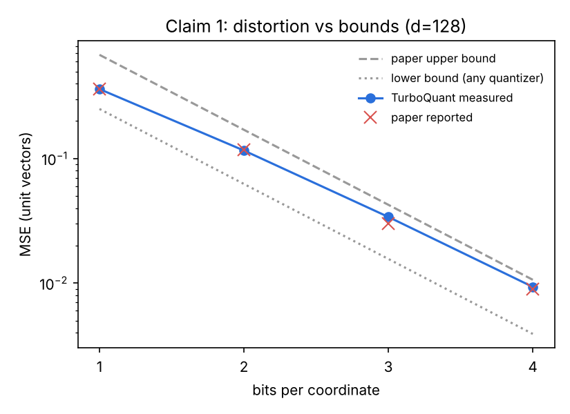
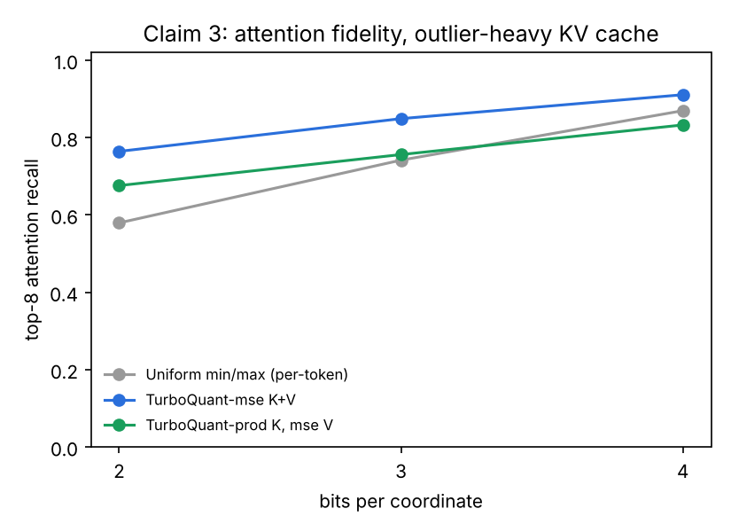

# Experiment 01 results

_seed=0, n=20000, quick=False, runtime=15.4s_

## Claim 1: MSE distortion is within ~2.7x of the information-theoretic optimum

| d | bits | mse | paper | lower | upper | ratio |
|---|---|---|---|---|---|---|
| 128 | 1 | 0.3610 | 0.36 | 0.2500 | 0.6802 | 1.44x |
| 128 | 2 | 0.1160 | 0.117 | 0.0625 | 0.1700 | 1.86x |
| 128 | 3 | 0.0340 | 0.03 | 0.0156 | 0.0425 | 2.17x |
| 128 | 4 | 0.0093 | 0.009 | 0.0039 | 0.0106 | 2.39x |
| 1024 | 1 | 0.3631 | 0.36 | 0.2500 | 0.6802 | 1.45x |
| 1024 | 2 | 0.1173 | 0.117 | 0.0625 | 0.1700 | 1.88x |
| 1024 | 3 | 0.0345 | 0.03 | 0.0156 | 0.0425 | 2.21x |
| 1024 | 4 | 0.0095 | 0.009 | 0.0039 | 0.0106 | 2.43x |

## Claim 2: MSE quantizer is biased for inner products; prod variant is unbiased

slope = 1.0 means unbiased. Theory says MSE at 1 bit shrinks inner products by 2/pi = 0.637.

| method | bits | slope | bias | rmse |
|---|---|---|---|---|
| TurboQuant-mse | 1 | 0.639 | -0.2168 | 0.2180 |
| TurboQuant-prod | 1 | 1.003 | +0.0019 | 0.0599 |
| TurboQuant-mse | 2 | 0.884 | -0.0695 | 0.0734 |
| TurboQuant-prod | 2 | 1.002 | +0.0009 | 0.0438 |
| TurboQuant-mse | 3 | 0.966 | -0.0204 | 0.0259 |
| TurboQuant-prod | 3 | 1.001 | +0.0004 | 0.0264 |
| TurboQuant-mse | 4 | 0.991 | -0.0056 | 0.0106 |
| TurboQuant-prod | 4 | 1.000 | +0.0001 | 0.0146 |

## Claim 3: attention on a compressed, outlier-heavy KV cache

fp16 baseline = 16 bits/coord. bits_per_coord includes per-vector norms/scales. kl = KL(true attention || quantized attention), mean (and std) over 5 random rotations; top8 = overlap of the 8 most-attended tokens; out_cos = cosine of attention outputs.

| method | bits | bits_per_coord | compression | kl | kl_std | top8 | out_cos |
|---|---|---|---|---|---|---|---|
| Uniform min/max (per-token) | 2 | 2.25 | 7.1x | 7.1890 | 0.0000 | 0.580 | 0.6484 |
| TurboQuant-mse K+V | 2 | 2.12 | 7.5x | 0.2869 | 0.0881 | 0.764 | 0.9024 |
| TurboQuant-prod K, mse V | 2 | 2.25 | 7.1x | 2.3457 | 1.4890 | 0.676 | 0.7960 |
| Uniform min/max (per-token) | 3 | 3.25 | 4.9x | 0.4922 | 0.0000 | 0.742 | 0.9328 |
| TurboQuant-mse K+V | 3 | 3.12 | 5.1x | 0.1540 | 0.1122 | 0.849 | 0.9551 |
| TurboQuant-prod K, mse V | 3 | 3.25 | 4.9x | 0.4921 | 0.1493 | 0.756 | 0.9303 |
| Uniform min/max (per-token) | 4 | 4.25 | 3.8x | 0.0845 | 0.0000 | 0.870 | 0.9737 |
| TurboQuant-mse K+V | 4 | 4.12 | 3.9x | 0.0908 | 0.0619 | 0.911 | 0.9744 |
| TurboQuant-prod K, mse V | 4 | 4.25 | 3.8x | 0.1787 | 0.1732 | 0.833 | 0.9653 |

## Quantization throughput (single CPU process, d=128, 3 bits)

| method | vec_per_s |
|---|---|
| Uniform min/max | 462,653 |
| TurboQuant-mse 3b | 206,243 |
| TurboQuant-prod 3b | 136,982 |

